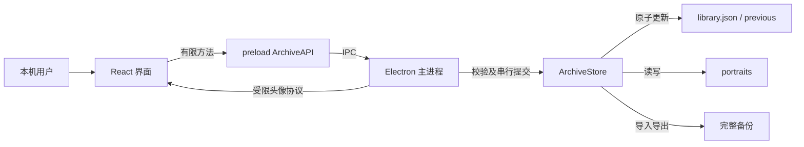

# 01 · 系统架构

本项目是个人离线桌面应用，唯一运行环境是用户的 Mac。元数据和头像由 Electron 主进程管理；界面从安装包加载，没有后端服务器。审查日期为 2026-10-28（Asia/Shanghai），基线是从空仓库实现的 v1.0.0 工作树，包含当次已验证代码与打包脚本。

阅读顺序：[调用链](02-core-call-chains.md) → [工程边界](03-engineering-findings.md) → [后续路线](04-optimization-roadmap.md) → [学习手册](05-engineering-handbook.md) → [问答](06-interview-questions.md)。源码路径以仓库根目录为基准。实际验证见 [验收记录](evidence/verification.md)。

箭头表示调用或数据访问，不代表线程并行。`ArchiveStore.serial` 保证业务写操作顺序；图片解码及 gzip 目前仍在主进程执行。

`src/App.tsx` 拥有 UI 快照、筛选条件和选中角色；`src/Editor.tsx` 拥有未提交草稿和图片预览；`electron/store.ts` 拥有权威内存快照并向文件提交。`shared/model.ts` 定义契约，`electron/main.ts` 负责对话框、IPC 来源和图片处理；职责细分见根目录 [architecture.md](../../architecture.md)。

角色创建/修改必须经过 `validateFields`；备份还需 `validateLibrary` 和图片解码。保存成功的含义是元数据原子替换完成，此后才更新内存和界面。元数据与新头像不是一次跨文件事务，失败可遗留未引用图片。原文件保留策略和自动备份使恢复有明确入口，但不代替异地备份。

运行依赖随 Electron 包交付；React/Lucide 由 Vite 打入静态资源，主进程由 esbuild 打为 CommonJS。精确版本由锁文件固定。源码模式与打包后二进制均通过桌面验收；未覆盖其他系统、真实大库及 Apple 公证分发。
